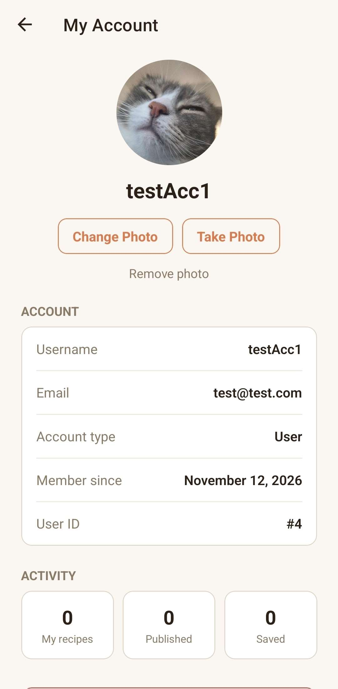
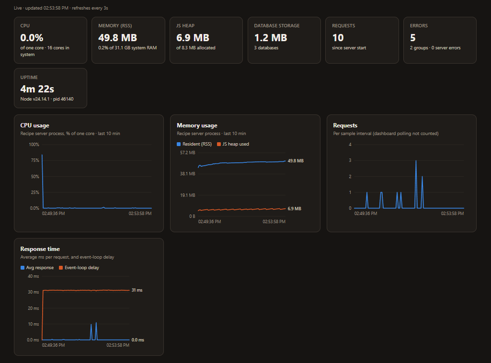

# Recipe Compiler

An app for saving recipes and **compiling** several of them into one timed cooking plan, so every dish is ready at the same time. It runs on phones (through Expo) and in a web browser, and talks to a small Node server that stores accounts and recipes.

## Features

### Recipes

- Create, edit and delete recipes. Each has ingredients (with amounts and units) and steps (with times in seconds, minutes or hours).
- Add a picture to a recipe from the photo library or the camera. It's cropped and resized automatically.
- Keep a recipe private or publish it for everyone.
- Open any recipe on its own page with its picture, author, ingredients, steps and total time.
- Each recipe gets its own colour, which it keeps across the compile, plan and timeline screens.

### Discover and saving

- Browse every published recipe, newest first, 10 per page.
- Search by recipe name, ingredient or author.
- Save other people's recipes to your Saved list and use them in plans.

### Compiling and plans

- Pick several recipes and compile them into one plan:
  - Ingredients are combined into one shopping list. The same ingredient is summed when the units match and listed side by side when they don't.
  - Steps are placed on one shared timeline so every dish finishes together.
  - Mark a recipe as an **appetizer** to have it finish as soon as possible instead.
  - Set an **end time** (when you want to eat), or start right away.
- Save plans on the device and come back to them later.
- Cook from a plan:
  - live countdowns for each step
  - the clock time each step should start
  - one active step per recipe at a time
  - a notification when a step's timer runs out
- **Make This**: start cooking a single recipe straight away as a temporary session. It works like a plan, and you can save it as a plan if you want to keep it.

### Accounts

- Register and sign in with a username or email address.
- Upload a profile picture.
- The **My Account** page shows your details and counts of your recipes, published recipes and saved recipes. You sign out from here.
- The first account registered becomes an admin. Admins can edit or delete any recipe.
  

### Server

- One Node server, with no third-party packages:
  - stores accounts and recipes in SQLite (Node's built-in `node:sqlite`)
  - serves the website build of the app at `/`
  - serves the data API under `/api/…`, which needs a signed-in session
- Security:
  - scrypt-hashed passwords and expiring session tokens
  - pictures are served from random, unguessable links
  - only the server's own website, the local Expo dev server and origins you list may call the API from a browser
  - strict security headers (Content-Security-Policy, no-store, nosniff, no framing)
- **Admin dashboard** at `/admin` (admins only):
  - live CPU, memory, request and event-loop charts
  - database storage use
  - errors grouped by type, with stack traces
  - a sortable, searchable view of every database table, with passwords, tokens and image data hidden
    

## Getting started

You need **Node 22.5 or newer**. Node 24 is recommended. On Windows, run the server from PowerShell, not WSL.

```bash
npm install
npm run build:web   # build the website (re-run after changing the app)
npm run server      # start the server on port 3000; data goes in server/data
npm start           # start the Expo dev server for the phone app
```

- Website: http://localhost:3000, or `http://<this computer's IP>:3000` from another device on your network
- Admin dashboard: http://localhost:3000/admin
- Phone app: scan the QR code from `npm start` with Expo Go or a development build

The phone app looks for the server on the same computer as the Expo dev server. To use a different server, put `EXPO_PUBLIC_API_URL=http://<host>:3000` in a `.env` file.

## Server commands

| Command                            | What it does                                                                                                                   |
| ---------------------------------- | ------------------------------------------------------------------------------------------------------------------------------ |
| `npm run server`                   | Starts the server                                                                                                              |
| `npm run make-admin -- <username>` | Makes an account an admin                                                                                                      |
| `npm run reset-password`           | Sets a new password for an account. It asks for the username, then the password; leave the password blank to get a random one. |
| `npm run seed-examples`            | Adds an `example_chef` account with sample published recipes                                                                   |

### Settings (environment variables)

| Variable          | Default       | Purpose                                                               |
| ----------------- | ------------- | --------------------------------------------------------------------- |
| `PORT`            | `3000`        | Port the server listens on                                            |
| `DATA_DIR`        | `server/data` | Where the database files are kept                                     |
| `WEB_DIR`         | `dist`        | Where the website build is served from                                |
| `ALLOWED_ORIGINS` | _(none)_      | Extra websites, comma-separated, that may call the API from a browser |

## Tech stack

- **App:** Expo SDK 58, React 19, React Native 0.88, expo-router and react-native-web
- **On-device storage:**
  - recipes and plans are kept in JSON files (expo-file-system)
  - the sign-in token is kept in expo-secure-store, or in localStorage on the web
- **Server:** plain Node.js. It uses `http`, `node:sqlite` and `crypto` and has no npm dependencies.
- **Databases:** two SQLite files:
  - `accounts.db` holds users, sessions and profile pictures
  - `recipes.db` holds recipes, saved recipes and recipe pictures

## Project layout

```
app/          Screens (expo-router) and the recipe/plan stores
components/   Shared UI (recipe cards, avatar, menu, pagination, …)
lib/          API client, sign-in, image picking, quick plans
server/       Node server, admin dashboard and website hosting
```

## Security note

The server uses plain `http://`, which is fine on a home network. Put it behind HTTPS before exposing it to the internet, otherwise passwords and session tokens travel unencrypted.

## License

[MIT](LICENSE)
